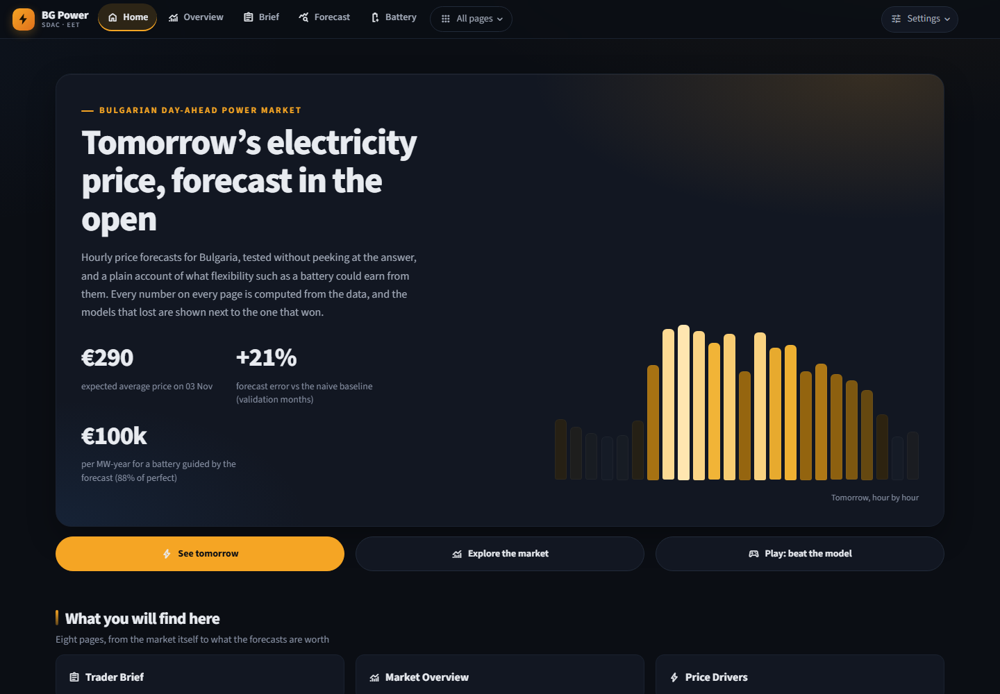
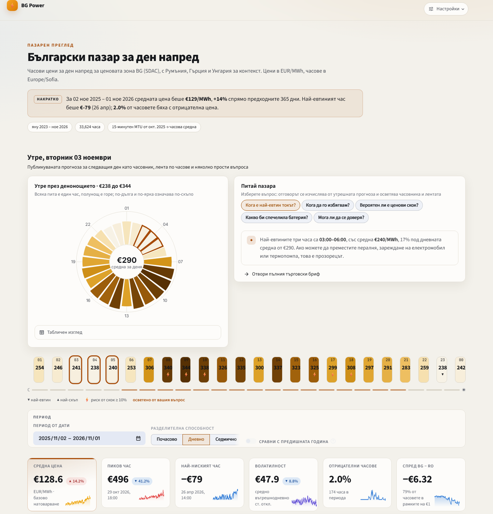
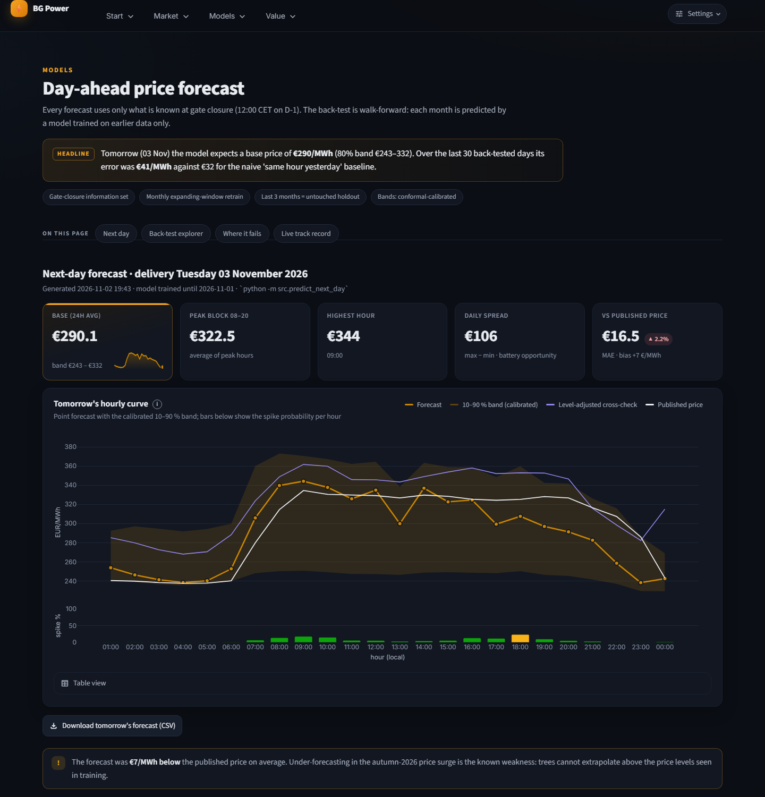
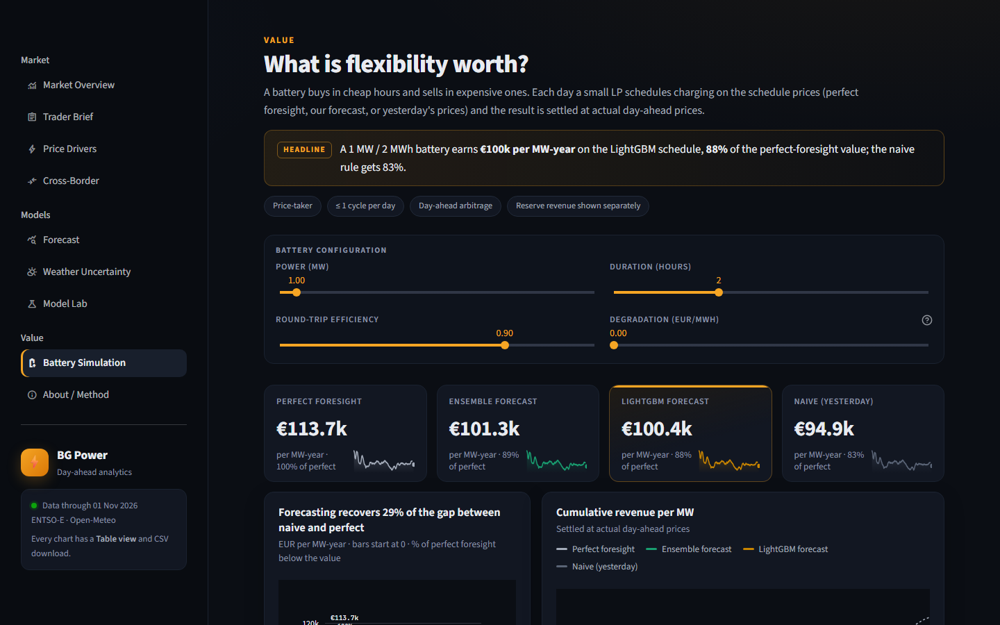
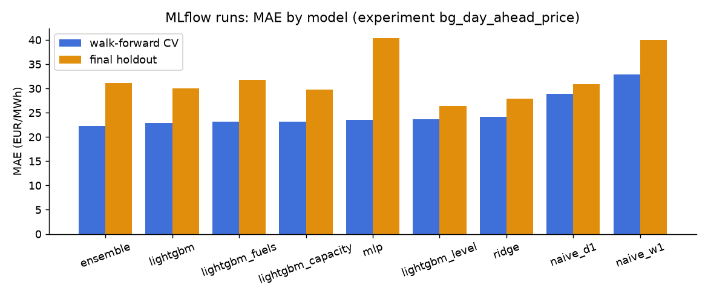

# Bulgarian Day-Ahead Electricity Market: Analytics, Forecasting and Flexibility Value

[](https://github.com/aleks-al-aleksandrov/energy-market-analytics/actions/workflows/ci.yml)
[](https://github.com/aleks-al-aleksandrov/energy-market-analytics/actions/workflows/next_day_forecast.yml)
 

**Live dashboard:** https://energy-market-analytics-1.streamlit.app/ (sign-in required; see *Sign-in* below)

Market analytics and machine learning on the Bulgarian (BG) day-ahead power market, built on the
ENTSO-E Transparency Platform and Open-Meteo. The project has two layers:

* **Analytics (Business Analyst):** what drives BG prices, how BG couples with RO / GR / HU, when prices
  spike or go negative, and what flexibility is worth, in EUR.
* **ML (Data Scientist):** next-day hourly price forecasts with walk-forward validation, tuning,
  probabilistic forecasts, a spike classifier, SHAP, significance tests, experiment tracking and drift
  monitoring.

> A forecast only matters if it makes or saves money. Every model result here is converted into
> battery revenue and compared with a naive rule.

## Dashboard Preview

| Home | Market Overview (Bulgarian, light theme) |
| :---: | :---: |
|  |  |

| Day-Ahead Forecast & Uncertainty | Battery Value & Dispatch |
| :---: | :---: |
|  |  |

*Market Overview in English/dark is `reports/figures/dashboard_overview.png`. Screenshots are regenerated with headless Chrome against a running dashboard.*

## At a glance

* **What works:** next-day hourly BG price forecasts that beat "same hour yesterday" by **21–23 %** over 25 walk-forward
  months (95 % interval 17–26 %), statistically significant; calibrated 10–90 % bands (80 % coverage on CV); a level-relative
  spike classifier; a battery arbitrage case worth about **€100k per MW-year** (88 % of perfect foresight).
* **What does not:** on the final 3-month holdout (Aug–Oct 2026, a price surge beyond the training range) the main model
  is only +2.7 % better than naive (95 % interval −10 % to +19 %, not significant). Fuel and carbon prices, interconnector
  capacities and plant outages did **not** improve the forecast when tested, and the neural net lost.
* **How it is checked:** 54 automated tests (no-leakage tests for the whole feature builder, evaluation maths, walk-forward
  splits, battery physics, data validation, every dashboard page), CI on every push, data validation that stops the pipeline on
  broken inputs, a pre-set rule for adopting any new feature group, and a live track record that fills in from the first
  scheduled run. Open `app/dashboard.py` → *Trader Brief* for the decision-oriented view.

## Headline results

Data: 2023-01-01 to 2026-10-31, hourly (33,600 hours). Walk-forward CV covers 25 monthly folds
(2024-07 to 2026-07). The final holdout is 2026-08 to 2026-10. All numbers are in EUR/MWh unless stated
otherwise, and every number below is regenerated by `python -m src.run_all --plus`.

### Market insights (notebook 02, dashboard pages 1–3)

| Question | What the data shows | So what |
|---|---|---|
| Daily shape | Cheapest hour 13:00 (avg 66), dearest 20:00 (181). In May–Aug the midday trough averages 44 vs an evening peak of 202. | Buy or charge at midday, sell into the evening ramp. |
| Residual load | Spearman ρ = 0.57 with price. The median price rises from 13 in the lowest residual-load bin to 169 in the highest. | The residual-load forecast is the key fundamental input. |
| Generation mix | In the dearest 10 % of hours lignite runs +786 MW and solar −1,016 MW compared with the cheapest 10 %. | Lignite and hydro set the evening price; solar sets the floor. |
| Extremes | 410 negative hours, growing from 11 (2023) to 174 (2026 YTD), peaking at 14:00 and in April. Spikes above P99 (330) cluster at 20:00. | Negative prices are a sunny-midday risk; spikes are an evening risk. |
| Cross-border | BG is within €1 of RO in 91 % of hours and of GR in 69 %. Convergence with RO fell from about 92 % (early 2026) to 47 % (Oct 2026). | The region usually sets BG's price, and decoupling is rising. |
| Daily spread | Average daily max−min spread is 158, highest in September (229) and lowest in February (105). | This spread is the battery's revenue pool. |

### Forecasting (notebooks 03 and 04)

| Model | CV MAE (mean ± sd over folds) | CV skill | Holdout MAE | Holdout skill | DM vs naive (holdout) |
|---|---|---|---|---|---|
| Naive: same hour yesterday | 28.9 ± 7.6 | — | 30.8 | — | — |
| Naive: same hour last week | 32.8 ± 10.9 | −13.5 % | 40.0 | −29.6 % | worse |
| Ridge | 24.2 ± 6.7 | +16.5 % | 27.9 | +9.4 % | p = 0.07 |
| LightGBM (Optuna-tuned) | 22.8 ± 6.9 | +21.1 % | 30.0 | +2.7 % | p = 0.75 |
| LightGBM, level-adjusted target ¹ | 23.7 ± 7.7 | +18.2 % | **26.4** | **+14.5 %** | **p = 0.008** |
| MLP (PyTorch) | 23.5 ± 6.5 | +18.7 % | 40.3 | −30.7 % | significantly worse |
| Ensemble (0.55 LGBM / 0.15 Ridge / 0.30 MLP) | **22.3 ± 6.5** | **+22.9 %** | 31.1 | −0.9 % | p = 0.91 |

All CV improvements over the naive baseline are significant (Diebold-Mariano p < 0.001).
¹ This variant was added *after* the holdout diagnosis below, so its holdout score is not a clean test. By the
pre-set rule (choose on CV), plain LightGBM stays the production model.

**Honest conclusion.** Across two years of walk-forward CV the models beat the naive baseline by 16–23 % and
the gain is statistically significant. On the 3-month holdout they barely do. The reason is clear in the data:
in October 2026 the average price jumped to €232/MWh, above almost anything in training (Aug–Oct averages
143 → 166 → 232). LightGBM under-forecast October by €29/MWh on average, because trees cannot extrapolate
beyond the target range they have seen. Ridge extrapolates and holds up better. A model of the deviation from
yesterday's level (`LevelAdjusted`) fixes most of the gap, but it is slightly worse in the calmer CV period.
The missing driver is the fuel and CO₂ price level, plus outages and interconnector capacity; none of these
are in the data. The neural net matches LightGBM on CV but degrades badly out of regime, and the ensemble
inherits that. The next-day forecast for 2026-11-02 (mean €278) also landed €40 below the published price
(mean €318).

Other ML results:
* **Optuna** (50 TPE trials, last 4 CV months): CV MAE improved from 19.62 to 19.09.
* **Ablation** (drop one group, last 12 CV months): calendar +2.23, price lags +1.28, weather +0.63,
  neighbours +0.18, system forecasts +0.14, flows −0.11 (flows add nothing).
* **SHAP:** the main drivers are yesterday's same-hour price, then RO and HU prices of D-1, the same-weekday
  price, day of week, and residual load. The partial dependence on residual load rises monotonically. The
  drivers match market logic, and no same-day actual quantity is used, so there is no sign of leakage.
* **Quantiles (10/50/90) and conformal recalibration** (`src/calibrate.py`): the raw 10–90 % band covered only
  62 % of CV outcomes (target 80 %). Widening each side by the 90 % conformal quantile of its recent out-of-sample
  misses (only days up to D-2 are used; the window length is chosen on CV months only, 180 days) lifts CV coverage
  to **80.0 %** at the price of a wider band (mean width €44 → €63). On the holdout coverage rises from 48 % to
  **68 %** but still falls short: the October-2026 surge put 28 % of outcomes above the band (only 4 % below), so
  a calibration built from calmer months cannot fully absorb a regime shift. Shorter windows adapt faster (30 days:
  75 % on the holdout) but I did not switch after seeing the holdout. `predict_next_day` applies the calibrated band.
* **Spike classifier** (threshold chosen at cost FN = 5 × FP on CV months): the fixed-EUR definition (price above
  the training P95) stops working after the level shift: it is exceeded in 43 % of holdout hours. The
  **level-relative definition** (price above yesterday's daily mean by more than the training-P95 excess, €87 now)
  keeps the event rate at 7.7 % on the holdout: CV PR-AUC 0.61 vs a 6.5 % base rate, holdout PR-AUC 0.53 vs 7.7 %
  (about 7× lift) with precision 0.38 and recall 0.66. The live forecast uses this definition, so tomorrow's spike
  probability is meaningful (2–12 % per hour) instead of 100 % in every hour. **Cheap-hour classifier** (price below €5, about ten times
  more events than strictly negative prices and the event a battery cares about): CV PR-AUC 0.75 vs a 5.5 % base rate, holdout
  PR-AUC 0.50 vs 2.1 % (about 24× lift) with recall 0.94 and precision 0.38. **Negative-price classifier:** CV
  PR-AUC 0.56 vs a 1.9 % base rate; only 8 negative hours on the holdout, so that result is not informative.

### Fuel and carbon prices: do they help? (`src/fuels.py`, `src/fuel_experiment.py`)

ENTSO-E carries no fuel or carbon prices, and the autumn-2026 surge (TTF about €104/MWh, up from €71 at the end of
September; Brent about $118) is exactly what the models missed, so this was tested properly, twice.

* **Sources:** daily TTF from OilPriceAPI (free tier, key in `.env`), daily Brent and a carbon ETC proxy from
  Yahoo Finance, EU gas monthly from the World Bank Pink Sheet. The vendor's daily TTF matches the World Bank monthly
  means within about 1 % (correlation 1.0 over 11 months). The free tier only returns the latest 500 days
  (from 2025-05-07), so each refresh is merged into a local cache and the history keeps growing; before May 2025
  the TTF level falls back to the monthly gas value.
* **No leakage by construction:** daily averages are used from D-2 only; a Pink Sheet month only from day 5 of
  the following month. `tests/test_fuels.py` checks that changing any later price never changes a feature
  (`python -m pytest tests`, 5 tests).
* **Adoption rule fixed in advance:** the group enters the production model only if it lowers LightGBM CV MAE on the
  last 12 CV months. It did not, so it is **off** in the headline model.
* **Fixed set of encodings, CV months only** (`reports/fuel_experiment.csv`; MAE in EUR/MWh, 12 CV months):

| Fuel features | LightGBM | Level-adjusted LightGBM |
|---|---|---|
| none | **20.13** | 20.68 |
| monthly gas + Brent + carbon (8) | 20.38 | 20.84 |
| levels only | 20.47 | 20.91 |
| scale-free changes only | 20.22 | 20.68 |
| daily Brent + carbon | 20.36 | 20.65 |
| monthly gas only | 20.43 | 20.90 |
| **daily TTF (3 features)** | 20.70 | 20.97 |
| daily TTF, scale-free (2) | 20.58 | 20.87 |
| daily TTF + Brent + carbon | 20.39 | 20.77 |
| all 11 fuel features | 20.60 | 21.00 |

No encoding beats "none"; the best alternative is −0.03 (noise) and daily TTF is worse by 0.2–0.6.
* **Why:** (1) yesterday's price and the neighbours' prices already carry the fuel level (daily TTF correlates 0.65
  with BG power in levels, but that information is already in the price lags); (2) the model's errors do correlate
  with the TTF level (+0.34 on 457 days: it under-forecasts when gas is high), but that is the regime problem again.
  There is only one high-gas episode in 16 months of daily history, and tree models cannot extrapolate to it;
  (3) the daily history is short, so most of the training rows only see the monthly proxy.
* **What would change this:** about a year more of daily TTF (the cache grows daily via the GitHub Action),
  or a paid tier with history back to 2023, plus a simple error-correction model on the TTF level. This is
  worth re-testing then, with the same rule.
* The with-fuels model still runs on the walk-forward and the holdout (`lightgbm_fuels` in the model table),
  so the comparison is visible: with all 11 fuel features CV MAE is 23.11 vs 22.84 and holdout MAE 31.80 vs 30.02
  (worse on both).



*Generated from the MLflow tracking store (`src/tracking.py`). Run `mlflow ui --backend-store-uri
sqlite:///mlflow.db` for the interactive comparison page.*

### Confidence intervals and regime robustness (`src/robust_experiment.py`)

**Skill with 95 % intervals** (moving-block bootstrap over delivery days, blocks of 7 days, 2,000 resamples):

| Model | CV skill vs naive | Holdout skill vs naive |
|---|---|---|
| Ridge | +16.5 % [13, 19] | +9.4 % [0, 20] |
| LightGBM | +21.1 % [17, 24] | +2.7 % [−10, 19] |
| Ensemble | +22.9 % [19, 26] | −1.0 % [−14, 15] |
| LightGBM, level-adjusted | +18.2 % [14, 22] | +14.4 % [4, 25] |
| 50/50 blend (LightGBM + level-adjusted) | +20.8 % [17, 24] | +14.1 % [4, 25] |

On the holdout only the level-anchored models and Ridge exclude zero.

**The October problem.** Trees cannot extrapolate beyond the target range they were trained on; in October 2026 the average
price reached €232/MWh. Candidates were fixed in advance: baseline, level-adjusted (target = price − yesterday's mean),
recency-weighted (half-life 90 days), Ridge + tree on the residual, a 50/50 blend, a "guarded" switch (level-adjusted only when
yesterday's mean exceeds the training P98), and, added after seeing the first results (so it adds to the multiplicity),
a level/shape split (linear daily level + LightGBM on the hourly shape). **Rule, fixed in advance:** a variant replaces the
baseline only if its CV MAE is ≥ 0.1 lower *and* Diebold-Mariano gives p < 0.05 on the CV months.

| Variant | CV MAE | Holdout MAE |
|---|---|---|
| LightGBM (baseline) | **22.84** | 30.02 |
| level-adjusted | 23.68 | 26.39 |
| 50/50 blend | 22.93 | 26.50 |
| guarded switch | 23.23 | 27.31 |
| level + shape | 24.08 | 26.56 |
| Ridge + tree | 23.29 | 27.81 |
| recency-weighted | 23.40 | 34.92 |

**No variant meets the rule, so the baseline stays the headline model.** The pattern is consistent: level-anchored variants
lose a little on CV and gain about 3.5 MAE in the October episode; in the 8 earlier "level-shift" months (price moved ≥ 25 %
versus the previous three months, `reports/robust_episodes.csv`) they mostly did not help. They are cheap insurance against
extrapolation, not a tested improvement; recency weighting is clearly worse on the holdout. The next-day forecast therefore
also shows the level-adjusted cross-check and the blend, and the Trader Brief warns when they disagree by more than 10 %. On the
one day I could check against published prices after the fact (3 Nov 2026, not a clean live test) the main model had MAE 16.5,
the blend 17.6 and the level-adjusted model 28.2.

The Diebold-Mariano test was checked by Monte Carlo (`tests/test_evaluate.py`): for equally accurate models it rejects at the
5 % level 5.5–7 % of the time, i.e. it is mildly liberal. The headline CV tests have p-values far below that margin;
borderline holdout results (p = 0.07–0.1) should be read with that in mind.

### Other inputs: interconnector capacity and plant outages (`src/outages.py`, `src/outage_experiment.py`)

* **Day-ahead interconnector capacities (NTC)** for RO ↔ BG and GR ↔ BG are published before the auction and are complete
  (6 features, `capacity` group). They are informative in isolation (the average |BG − RO| gap is €5.3 when import capacity is in its
  lowest 20 % against €2.6 otherwise) but **did not pass the adoption rule**: CV MAE 20.54 with vs 20.13 without
  (last 12 CV months, greedy rule in `run_all.decide_optional_groups`). Price lags already carry most of this.
* **Plant outages (REMIT).** The ENTSO-E API returns only the *latest revision* of every outage document (849 documents,
  up to 48 revisions each), so what was known at gate closure on a past day **cannot be reconstructed**: a "published before
  gate closure" filter undercounts old days (for one 60-day window it sees 11 MW of lignite outages against 136 MW in the final
  documents), and ignoring publication time would leak the future. So outages are **not a model feature**. As an upper bound,
  perfect (leaky) knowledge of the final outage windows changes CV MAE by +0.04 (20.17 vs 20.13), and the strict, leak-free
  version by −0.04: **even perfect outage knowledge does not help**. `predict_next_day` still records a point-in-time outage
  snapshot to `reports/outage_pit.csv` each run, so a clean history accumulates if it is ever worth revisiting.
* **Re-test (2026-11-03, `src/retest_optional.py`).** A probe on a fully past month (April 2026) still returns exactly one revision per
  document (22 documents, none with several), and only 1 of the 180 point-in-time snapshot days needed exist, so outages remain
  untestable without leakage. Capacity and fuels were re-run on the current data under the same rule: CV MAE 20.53 with capacity and
  20.60 with fuels against 20.13 without either, so neither is adopted. The script runs weekly in the forecast workflow, writes
  `reports/retest_status.json`, shows the result on the About page, and re-runs the outage experiment automatically the day either
  precondition is met.

### Weather uncertainty (notebook 04b)

| Setup (same LightGBM, 2024-07 to 2026-10) | Price MAE |
|---|---|
| Oracle: observed weather of day D | 23.69 |
| Realistic: Open-Meteo forecast issued D-1 | 23.62 |
| No weather features | 24.17 |

Weather features are worth about €0.55/MWh of MAE. The oracle is no better than the realistic D-1 forecast,
and injecting 0.5–2× the measured weather-forecast error leaves price MAE at 24.5–24.7. Two findings explain
this:
1. The ENTSO-E solar forecast error is large (MAE 241 MW, 37 % of mean output, rising to about 440 MW in
   2026) but essentially uncorrelated with the point-weather error (R² ≈ 0). That points to capacity growth
   and curtailment, not weather.
2. The residual-load forecast miss has no relationship with the day-ahead price error. That is market logic:
   the day-ahead price clears on D-1 forecasts, so realised misses move intraday and imbalance prices instead.
   Weather risk is therefore an intraday and balancing exposure.

### Battery value (notebook 05)

1 MW / 2 MWh, 90 % round-trip efficiency, one cycle per day, settled at actual day-ahead prices over 853 days:

| Schedule | EUR per MW-year | % of perfect foresight |
|---|---|---|
| Perfect foresight | 113,700 | 100 % |
| Ensemble forecast | 101,300 | 89 % |
| LightGBM forecast | 100,400 | 88 % |
| Naive (yesterday's prices) | 94,900 | 83 % |

The forecast is worth about **€5,400 per MW-year** over the naive rule. Sensitivity at 90 % efficiency:
1 h → 61k (forecast captures 86 %), 4 h → 194k (92 %). Revenue is driven by the daily spread: average daily
revenue is €134 in the lowest spread quartile and €542 in the highest.

**Monte Carlo revenue risk** (`src/montecarlo.py`, dashboard *Battery Simulation*): the battery schedule is fixed by the forecast; the
uncertainty is the price it settles at. Scenario revenue is the revenue expected at forecast prices plus a "slippage" (realised minus
expected revenue of a past day's own schedule) drawn from the last 180 days. A simpler generator that adds independent error vectors
to the forecast was tested too and rejected on the CV months: it covered only 72% of days in its P10-P90 range, because realised revenue falls
systematically short of the revenue expected at forecast prices (the optimiser's curse: the schedule sells where the forecast is too high).
Calibration back-test (each day uses only earlier errors): the P10-P90 range holds **83%** of CV days (target 80%) and
**70%** of holdout days, so it is too narrow in the autumn-2026 regime shift. Scenario years (7-day blocks) give a median of
EUR 82k per MW-year, P5-P95 EUR 74k-91k. Daily loss probability is conservative (4% predicted vs
0.6% realised). It is a scenario analysis conditional on recent errors, not a structural price model.

**Costs, risk filter and project view** (`src/battery_study.py`, dashboard *Battery Simulation*):

* **Degradation:** every €5/MWh of wear cost on throughput removes about €3.6k per MW-year; at €15/MWh the LightGBM schedule earns
  €89k instead of €100k (naive €84k, perfect foresight €103k). The forecast keeps its roughly €5.5k advantage over naive.
* **Confidence filter** (stay idle when the expected daily profit is below a threshold, chosen on CV months only): it adds nothing.
  Bulgarian daily spreads always cover the round-trip losses, so the best threshold on CV is €0 (trade every day).
* **Investment view:** payback, IRR, NPV and break-even capex from the back-tested net revenue, with capex, opex, lifetime and
  discount rate as sliders. All inputs are assumptions, not quotes; the robust number is the **break-even capex** (NPV = 0), which
  needs no capex assumption. It is based on 2023–2026 day-ahead arbitrage alone, a back-test, not a promise.
* **Balancing reserve capacity (indicative):** ENTSO-E publishes contracted reserve prices for Bulgaria. They are **constant for long
  stretches** (e.g. FCR €10 → €50 → €25/MW/h), which points to administered rather than competitively cleared prices, and the markets
  are tiny (FCR about 29 MW and aFRR-up about 110 MW contracted over the last 12 months). At the latest prices the capacity payment
  would be around €240k per MW-year for FCR/aFRR-up if fully awarded (about €47k for aFRR-down/mFRR-up), but a single battery is a large
  share of those markets and a small fleet saturates them, so the price-taker assumption fails. Activation, state-of-charge management
  and prequalification are ignored. The dashboard shows it separately with an "awarded and available" haircut slider.

See `MODEL_CARD.md` for intended use, evaluation summary and known failure modes.

## Quick start

```bash
python -m venv .venv && .venv\Scripts\activate        # Windows (source .venv/bin/activate on Linux/macOS)
pip install -r requirements.txt
copy .env.example .env                                  # then add ENTSOE_API_KEY (and optionally OILPRICE_API_KEY for daily TTF)
python -m src.tune --trials 50                          # optional: Optuna (time-based CV, holdout untouched)
python -m src.run_all --plus                            # ingest -> clean -> features -> models -> reports
python -m src.build_notebooks                           # regenerate and execute notebooks/
python -m src.calibrate                                 # conformal recalibration of the 10-90 % band
python -m src.robust_experiment                         # regime-robust variants, bootstrap intervals, level-shift episodes
python -m src.battery_study                             # degradation, confidence filter, reserve stacking
python -m src.montecarlo                                # Monte Carlo battery-revenue scenarios + calibration back-test
python -m src.outage_experiment                         # optional: value of (leaky) outage knowledge, CV only
python -m src.retest_optional [--groups]                # are outages testable yet? (revision probe + snapshot count); --groups re-runs capacity/fuels
python -m src.fuel_experiment                           # optional: do fuel/carbon features help? (CV only)
python -m pytest tests                                  # leakage tests (features, fuels) and track-record rules
python -m src.predict_next_day                          # reports/forecast_next_day.csv
streamlit run app/dashboard.py                          # dashboard (reads reports/ only, never the API)
mlflow ui --backend-store-uri sqlite:///mlflow.db       # experiment tracking
```

Downloads are cached month by month in `data/raw/` as Parquet, so re-running never downloads a chunk
twice. Only the current, incomplete month is refreshed. A full download from scratch takes about 15
minutes. `run_all --plus` takes about 45 minutes on a laptop CPU.

## Data

| Source | Dataset | Use |
|---|---|---|
| ENTSO-E | Day-ahead prices BG, RO, GR, HU | target, neighbour features, spreads |
| ENTSO-E | Actual total load | analysis, residual-load error |
| ENTSO-E | Day-ahead load forecast | feature (known before gate closure) |
| ENTSO-E | Day-ahead wind and solar forecast | feature, residual load |
| ENTSO-E | Actual generation per type | analysis only (never a feature) |
| ENTSO-E | Physical flows BG ↔ RO, GR, RS, MK, TR | net position (D-2 feature, analysis) |
| Open-Meteo | Historical Weather API (observed / reanalysis) | ground truth, oracle experiment |
| Open-Meteo | Previous Runs API, day-1 run (forecast issued on D-1) | **only weather feature** |
| Open-Meteo | Historical Forecast API | proxy before the D-1 archive starts (flagged) |
| World Bank Pink Sheet | EU natural gas (monthly, USD → EUR with monthly EUR/USD) | fuel features, lagged by publication date |
| OilPriceAPI | Daily TTF gas (EUR/MWh), free tier = latest 500 days, merged into a growing cache | fuel features (D-2 average) |
| Yahoo Finance | Brent (`BZ=F`), carbon ETC proxy (`CO2.L`), EUR/USD, TTF front-month snapshot | fuel features (D-2 close), TTF log |
| `holidays` | Bulgarian public holidays and bridge days | calendar features |

Weather points: Sofia (demand), Dobrich (north-east wind cluster), Stara Zagora (Thracian solar cluster).
History: 2023-01-01 to the last complete day.

### Data traps and how they are handled

* **Time zones / DST:** everything is stored in UTC, so 23- and 25-hour local days need no special case.
  The display uses Europe/Sofia. The delivery day is defined in market time (CET).
* **15-minute MTU:** BG day-ahead prices switched from 60-minute to 15-minute resolution in October 2025
  (see `reports/resolution_by_month.csv`). All series are resampled to the hourly mean.
* **Gaps:** gaps of up to 3 hours are linearly interpolated. Longer gaps stay missing, and those hours are
  dropped from training. Counts per series are in `reports/data_quality.csv`.
* **ENTSO-E column format change:** generation per type switches from flat columns to
  `(type, Actual Aggregated / Consumption)` once storage reports consumption. The cleaning step merges both.
* **Negative and extreme prices** are kept and flagged (`is_negative`). They are never clipped.
* **Leakage:** actual load, generation and same-day flows are never used as features. Weather features are
  D-1 forecasts, never observed weather of the delivery day.

## Method

**Information set at gate closure (12:00 CET, D-1):** BG and neighbour prices up to D-1, the ENTSO-E D-1
load / wind / solar forecasts for D, D-1 weather forecasts, calendar, and net physical flows up to D-2.
Feature groups (`reports/feature_groups.json`): calendar (cyclic hour and month, holiday, bridge day),
price lags (24h, 48h, 168h, same weekday ×3, D-1 mean/std/min/max, 7-day mean/std), neighbours (D-1
prices and BG−X spreads), system forecasts (load, wind, solar, residual load, ratio, daily mean and
ramp), flows, and weather.

**Validation:** expanding-window walk-forward. Retrain each month and test on the next month (from 2024-07).
The **last 3 months are a final holdout**. Optuna tuning, ensemble weights and classifier thresholds use
only the earlier CV months.

**Models:** naive same hour yesterday, naive same hour last week, Ridge, LightGBM (Optuna-tuned), PyTorch
MLP, weighted ensemble, quantile LightGBM (10/50/90 %), and a LightGBM spike / negative-price classifier.

**Metrics:** MAE, RMSE, skill score = 1 − MAE / MAE(best naive), Diebold-Mariano test (daily-averaged
loss differentials, Newey-West variance), and mean ± sd across monthly folds. MAPE is not used because
prices cross zero. Quantile forecasts use pinball loss and coverage. Classifiers use PR-AUC, precision,
recall and a cost-based threshold.

## Repository

```
src/
  config.py            paths, zones, period, weather points, seed
  ingest.py            ENTSO-E + Open-Meteo download with monthly Parquet cache and retry
  clean.py             UTC hourly alignment, 15-min resampling, gap handling, data-quality report
  features.py          gate-closure-safe features
  models.py            naive, Ridge, LightGBM (+quantile, classifier), PyTorch MLP
  evaluate.py          walk-forward, metrics, Diebold-Mariano
  tune.py              Optuna with time-based CV
  ml_plus.py           NN, ensemble, quantiles, classifier, SHAP, ablation, drift, weather study
  explain.py           SHAP plots and tables, partial dependence
  monitor.py           rolling MAE, PSI, retraining rule
  weather_study.py     forecast-vs-actual weather, oracle / realistic / no-weather, noise injection
  battery.py           daily LP arbitrage, settled at actual prices
  calibrate.py         conformal recalibration of the quantile band (leak-free)
  validate.py          data validation that stops the pipeline on broken inputs
  robust_experiment.py regime-robust variants, bootstrap intervals, level-shift episodes (pre-set rule)
  outages.py           plant-outage documents: leak-free limits, upper-bound frames, point-in-time recorder
  outage_experiment.py value of outage knowledge (CV only)
  retest_optional.py   weekly check of the preconditions for testing outages; re-tests capacity/fuels on demand
  reserve.py           balancing reserve prices and volumes for BG
  battery_study.py     degradation, confidence filter, reserve stacking
  montecarlo.py        Monte Carlo revenue scenarios (error-vector vs slippage generators) and calibration back-test
  track_record.py      live forecast log and scoring (pre-gate-closure runs only)
  fuels.py             lag-safe fuel & carbon features (no leakage by construction)
  fuel_experiment.py   do fuel prices help? fixed encodings, CV only
  predict_next_day.py  next delivery-day forecast file
  build_notebooks.py   generates and executes notebooks/
  run_all.py           one command end to end
app/                   Streamlit dashboard: dashboard.py (router), overview.py, home.py, views/ (9 pages), auth.py (optional sign-in), theme.py (dark/light palettes), i18n.py + i18n_bg.py (English/Bulgarian), signature.py (market clock, ribbon, Ask the market)
notebooks/             01 data quality · 02 insights · 03 forecasting · 04 ML deep dive · 04b weather · 05 battery
reports/               all results the dashboard reads (CSV / Parquet / figures)
tests/                 leakage, evaluation maths, walk-forward, battery, Monte Carlo, validation, translation and palette checks, dashboard smoke (every page in English/dark and Bulgarian/light)
.github/workflows/     ci.yml (tests on every push) and next_day_forecast.yml (daily forecast, stretch)
Makefile, Dockerfile   one-command targets; dashboard-only container
```

## Dashboard

`streamlit run app/dashboard.py` opens these pages: Market Overview (KPIs, price chart, calendar), **Trader Brief** (tomorrow's
forecast turned into rule-based actions, how far to trust it, and a playbook; every number computed from the project's files),
Price Drivers (including fuel and carbon), Cross-Border, Forecast (back-test with calibrated band, next-day card, error heatmap,
live track record), Weather Uncertainty, Model Lab (leaderboard with significance and bootstrap intervals, regime robustness,
SHAP, calibration, classifiers, drift), Battery Simulation (sliders, costs, investment view, reserve capacity) and About.
It reads only precomputed files in `reports/`.

**Design and accessibility** (`app/theme.py`, `app/style.css`): one design system for all pages. Chart colours are a fixed-order
categorical palette checked with a colour-blind (CVD) separation and contrast validator; emphasis is one accent against neutral
marks, thin marks, direct labels plus a legend, and no dual axes. Page titles and chart titles that state a finding are computed
from the data, not typed in. Filters sit in one bar above the content they scope. Every chart has a *Table view* with CSV download and
a screen-reader description; text meets WCAG AA contrast, focus is visible, touch targets are 44 px on small screens, and the layout
reflows down to phone width. The headless smoke test renders every page.
**Navigation and home.** One fixed header carries the brand, a single row of page links (current page highlighted; scrollable on phones, with the current page first) and a *Settings* menu (theme, language, data status, sign-out). Theme and language are kept in plain session keys, so they survive page switches; `EMA_AUTH_DISABLED=1` switches the sign-in off for local development only. The default page is **Home**: what the project is, three numbers computed from the
reports, a card for every page, how it works, and what makes it honest, with the same limits stated as on the other pages.

**Sign-in** (`app/auth.py`). On by default and fail-closed: until credentials exist in Secrets (or `EMA_AUTH_*` variables) nobody can sign in, so a forgotten secret never leaves a hosted copy open. For local work set `EMA_AUTH_DISABLED=1` (never online). To protect a deployed
app, create a hash with `python -m src.make_password_hash` and put it in `.streamlit/secrets.toml` (Community Cloud: App settings, Secrets):

```toml
[auth]
users = { alice = "pbkdf2_sha256$...", bob = "pbkdf2_sha256$..." }   # or: password = "pbkdf2_sha256$..." for one shared password
```

Passwords are checked as salted PBKDF2 hashes with a constant-time comparison, failed attempts are slowed down and locked for 60 s after
five. This keeps casual visitors out; it does not hide files that are in a public repository, so keep the repository private and also
use the host's own viewer allow-list if the data matters. `.streamlit/secrets.toml` is git-ignored.

**Light and dark theme, English and Bulgarian.** The sidebar switches theme and language; both are in the URL (`?theme=light&lang=bg`),
so a link opens exactly that view, and the browser language picks Bulgarian by default. Dark and light are two separately selected
palettes (the light one was run through the same CVD and contrast validator), not an automatic flip, and colours are resolved per
session so two visitors on different themes never share state. The Bulgarian text lives in `app/i18n_bg.py`, keyed by the English
source with computed numbers as placeholders; anything without a translation falls back to English, and a test fails if a default page
render contains untranslated sentences. Hover text, dates and month names are localised; Plotly's own axis tick formats stay English.

**Interactive extras.** The Overview opens with *Tomorrow around the clock*: the next-day forecast as a 24-hour dial and an hour
ribbon (every cell carries its number and a marker, never colour alone), with *Ask the market*, five plain questions whose answers are
computed from the forecast and light up the dial and ribbon (cheapest window, window to avoid, spike risk, what a battery would earn,
can I trust it). A month-by-month animation shows the solar dip deepening and fading. *Beat the Model* is a small game: schedule a
1 MW / 2 MWh battery for a past day, then see it settled against LightGBM, the naive forecaster and perfect foresight; the scoreboard
compares like for like over the days you played and warns that a handful of rounds proves nothing.

Navigation aids: a sticky *On this page* bar on the long pages (a single scrollable row on phones), a *Tomorrow* strip on the overview linking to the
Trader Brief, and *Where next* links at the foot of every page.

## Live track record and tests

* **Live track record** (`src/track_record.py`): every run of `python -m src.predict_next_day` is appended to
  `reports/forecast_log.csv` with its generation time. A forecast counts as *live* only if it was generated before
  gate closure (12:00 CET on D-1), and the first live forecast of an hour is never overwritten. Live forecasts are
  scored against the published day-ahead price and the naive baseline in `reports/live_track_record.csv`, shown on the
  Forecast page. The daily GitHub Action publishes both files, so this fills in from the first scheduled run.
* **Tests** (`python -m pytest tests`, 54 tests, also verified in a brand-new environment built from `requirements.txt`):
  the whole feature builder is checked for leakage (changing any price on the delivery day or later, or any flow from D-1 on,
  must leave every feature of that day unchanged, plus a sanity test that yesterday's prices *do* change the lag features), the
  fuel and outage features are checked the same way, the evaluation maths (Diebold-Mariano size by Monte Carlo, pinball loss,
  bootstrap intervals) and walk-forward splits (never train on the test month) are tested, the battery optimiser respects its
  physical constraints (power, capacity, cycles, efficiency, degradation, investment arithmetic), the data validation rules
  fire, and a headless smoke test runs **every dashboard page** against the committed reports.
* **Data validation** (`src/validate.py`): the pipeline stops on a broken schema, duplicate or irregular timestamps, prices outside the
  harmonised range, low coverage or a stuck feed, and warns on stale data (`reports/data_validation.csv`).
* **CI** (`.github/workflows/ci.yml`) runs the tests and the dashboard smoke test on every push. `Makefile` and `Dockerfile`
  give one-command setup, pipeline and a dashboard-only container.

## Deploying the dashboard

The dashboard only reads the committed files in `reports/`, so it can be hosted without the data or the models.
On Streamlit Community Cloud point the app at `app/dashboard.py`; the lightweight `app/requirements.txt` (no torch,
MLflow or SHAP) is picked up automatically. `requirements-lock.txt` pins the exact versions the project was tested with.

## Monitoring and retraining rule

Retrain monthly on the expanding window. Retrain immediately if the rolling 30-day MAE stays more than
**20 % above its CV level for 14 consecutive days**, or if a key feature (load, wind, solar or
residual-load forecast, D-1 prices) shows **PSI > 0.25** against the training reference.

In the back-test the rule would have fired on 101 days, in three episodes: summer 2024 (33 days),
the winter 2024/25 price peak (46) and the October-2026 surge (21, where D-1 price features also show
PSI > 2). PSI on load and solar partly reflects seasonal mix (the
reference is whole years), so read the month-by-month PSI heatmap in the Model Lab against the same months of
earlier years.

## Limitations

* Daily TTF history is only 16 months deep (free tier); no hydro reservoir levels. Brent, a carbon proxy, monthly and daily gas,
  interconnector capacities and (as an upper bound) plant outages were tested and did not help (see above). Outages cannot be
  used point-in-time from the API history.
* The headline model under-forecasts when the price level leaves the training range; the level-anchored variants help in the
  October-2026 episode but not in earlier level shifts, and no variant passed the pre-set rule.
* Forecasts are hourly (15-minute products are averaged); a quarter-hour model was not built.
* The ENTSO-E wind/solar day-ahead forecast has a legal publication deadline of 18:00 on D-1, which can be
  after gate closure. It is treated as available because traders hold equivalent vendor forecasts at
  12:00.
* The archived D-1 weather forecast exists only from February 2024. Earlier hours use a stitched
  short-lead forecast, flagged in `weather_fc_is_proxy` and excluded from the weather experiments.
* Calibrated bands still under-cover in a regime shift (68 % on the holdout, target 80 %); the live track record
  (below) will show how they behave out of sample.
* The battery base case is day-ahead arbitrage, price-taker, without network charges, taxes or intraday revenue. Degradation is a
  configurable cost; reserve capacity revenue is indicative only (administered prices, tiny markets).
